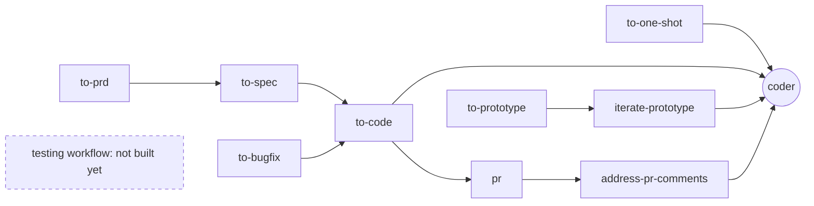

# Software orchestra

**Less factory, more orchestra. You hold the baton.**

You carry the cognitive load. The LLM carries the contextual load.

Most AI software factories gate only the plan and the merge, so you review one large diff at the end. This repo gates every step, so each decision reaches you small, with its context already gathered.

<!-- TODO: one sentence on who this is for and which repositories it targets. -->

## Why an orchestra

I don't want the future of software to be a dark factory, where code that no person wrote, read or understood ships because a pipeline said it was fine.

I want building software to stay human work. In an orchestra every player is skilled, and the music still needs someone who listens to every bar and decides how it should sound. That is the seat this repo keeps for you. The LLM plays the parts. You stay in the room, and the music is still yours.

The orchestra framing and the idea of slop-free zones come from Charlie Holtz's talk [Orchestras, Not Factories](https://www.youtube.com/watch?v=TRfzFJCJ7ZE). This repo is my take on putting them into practice.

## Pipeline

Every arrow is a decision you make.

## Find a skill

Define the work: turn an idea or bug into reviewed work

| Skill | Use it when |
| --- | --- |
| `to-prd` | You have rough requirements, notes or a draft algorithm and want a reviewed story. |
| `to-spec` | You have one or more stories and want a plan split into small pull-request slices. |
| `to-bugfix` | You have a bug report and want it reproduced and diagnosed before anyone fixes it. |
| `adr` | A decision is made that would be expensive to reverse, and you want it recorded. |

Build: turn reviewed work into code

| Skill | Use it when |
| --- | --- |
| `to-code` | You have a slice or bugfix artifact and want it implemented and reviewed locally. |
| `to-one-shot` | You want a small change with no story or spec behind it. The test scenarios are the whole plan. |
| `to-prototype` | You want to find out whether an idea works before committing to production code. |
| `iterate-prototype` | You want to run the next trial on a prototype, or close it with an assessment. |

Ship: in progress

<!-- TODO: skills that ship and deploy the code. -->

In progress.

Code health: fix code that looks wrong

| Skill | Use it when |
| --- | --- |
| `refactor` | A method or class needs restructuring with no change in behavior. |
| `wth-is-this` | You found bad code and want to know which missing guidance let it in, plus a fix for every place it appears. |

Improve the orchestra: make the setup better

| Skill | Use it when |
| --- | --- |
| `retro` | A session went badly or slowly and you want evidence-based changes to the setup. |

Rules and shared helpers (you don't start these)

| Skill | Kind | What it does |
| --- | --- | --- |
| `grown-ups` | Rule | Answers first, gives options instead of leading questions, asks only when blocked. |
| `doubt-driven-development` | Rule | Every claim comes with evidence. |
| `unslop` | Rule | Strips AI tells from writing. |
| `writing-agent` | Rule | Docs for an expert reader, with real names and numbered points. |
| `test-scenarios` | Helper | One row per scenario, with concrete values. |
| `show-me` | Helper | Diagrams and code sketches with real names. |

## Change levels

The most a skill can change. Higher levels are harder to undo, so their gates are stricter.

| Level | Can touch | Gate |
| --- | --- | --- |
| 0. Advise | Chat and throwaway files | None |
| 1. Write artifacts | Markdown in the artifact folders | Approval of the content |
| 2. Change code | Production and test code, uncommitted | Approval of scope before any edit |
| 3. Commit locally | Git history on a branch | Approval of the exact files and message |
| 4. Publish | Remote branches, pull requests, review threads | Approval of the exact content. Only you can start the skill. |

Full skill index

| Skill | Kind | Level | Started by |
| --- | --- | --- | --- |
| `grown-ups` | Rule | 0 | Always on |
| `doubt-driven-development` | Rule | 0 | Always on |
| `unslop` | Rule | 0 | Always on |
| `writing-agent` | Rule | 1 | Model or you |
| `show-me` | Helper | 0 | Model or you |
| `test-scenarios` | Helper | 1 | Model or you |
| `retro` | Workflow | 0 | You |
| `to-prd` | Workflow | 1 | You |
| `to-spec` | Workflow | 1 | You |
| `adr` | Helper | 1 | Model or you |
| `to-bugfix` | Workflow | 2 | You |
| `to-one-shot` | Workflow | 2 | You |
| `refactor` | Workflow | 2 | Model or you |
| `wth-is-this` | Workflow | 2 | You |
| `to-prototype` | Workflow | 3 | You |
| `iterate-prototype` | Workflow | 3 | You |
| `to-code` | Workflow | 4 | You |
| `pr` | Workflow | 4 | Model or you |
| `address-pr-comments` | Workflow | 4 | Model or you |
| `coder` | Agent | 2 | Workflows only |

## Not built yet

| Item | Why it matters |
| --- | --- |
| Status view | You still have to remember what is in flight. That is contextual load. |
| Testing workflow | Integration tests, coverage gaps, flaky tests. |
| Enforcement layer | Gates are written rules. No permission or hook enforces them yet. |

<!-- TODO: fill in or drop rows as decisions land. -->

## Install

<!-- TODO: depends on the target tool (Claude Code only, or also Copilot). -->

1. {Copy or link `skills/` into the target repository's skills folder.}
2. {Copy or link `agents/coder.agent.md` into the target repository's agents folder.}
3. Paste [the project profile template](templates/AGENTS-project-profile.md) into the target repository's `AGENTS.md` and fill in every blank.
4. Add [the always-on rules](docs/AGENTS.md) to the target repository's always-loaded instructions.

## Project profile

Skills read paths, tools and trackers from the "Project profile" in the target repository's `AGENTS.md` ([template](templates/AGENTS-project-profile.md)). A blank value makes the skill stop and ask.
